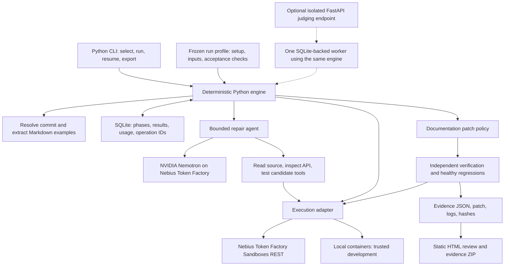
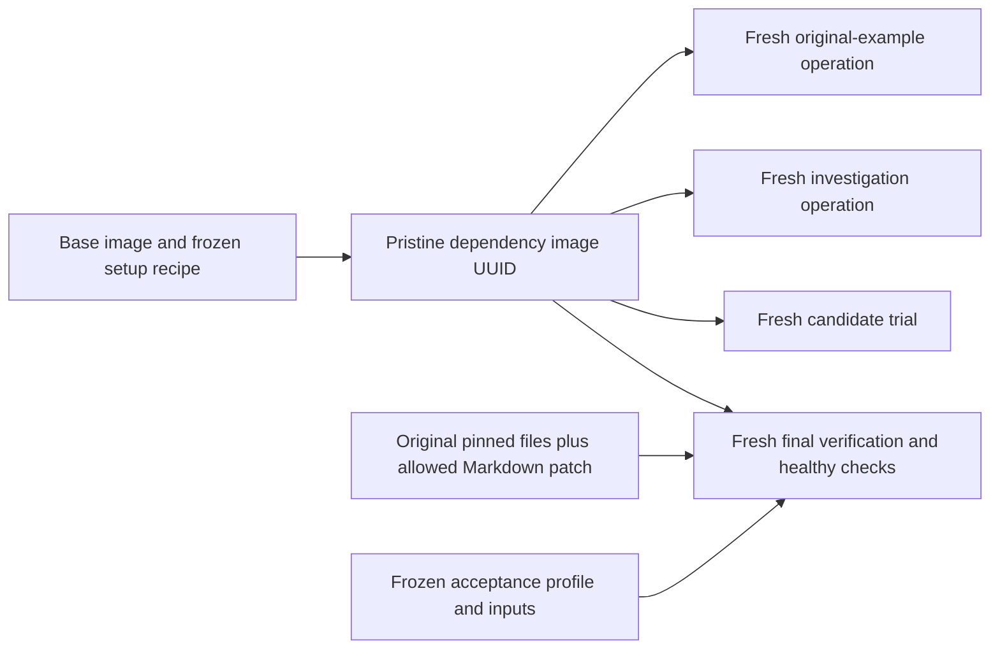

# DocDrift architecture and phased build plan

Planning date: October 12, 2026. Status: design only; implementation has not started.

## Recommendation and scope

Build a Python CLI that repairs one broken documentation example at a time and generates a polished review report. Target the Coding and Agentic Engineering track. Make clean, independently checked verification the center of the product. Keep NewsBias the primary project and use a provisional budget of **29 focused hours plus four hours of contingency**; reduce scope if less time is available.

Product promise: **a small documentation patch with evidence of the original failure, the repaired behavior, and preservation of previously working examples**. Verification applies to the behavior covered by a frozen check profile, not arbitrary semantic correctness.

Workspace inspection found no implementation files, no applicable `AGENTS.md` in this directory or its ancestors, and no usable Git repository. The existing hidden directories are empty/read-only workspace entries. This plan is the only file created. NewsBias was not modified.

The submission supports:

- Small, public, curated Python repositories resolved to a full commit SHA. Selection is through the CLI; the review report displays the resolved commit.
- `README.md` and up to four explicitly selected Markdown files, with standalone fenced `python` examples. Preserve source spans and exact Markdown formatting.
- Python 3.12, offline examples, and curator- or maintainer-authored environment and acceptance profiles. Profiles live outside the repository being repaired and are frozen before baseline execution.
- One repair target per run, at most two candidate patches, an actual NVIDIA Nemotron inference call through Nebius Token Factory, and a fresh final verification operation.
- Documentation-only patches, findings, execution logs, a unified diff, and a downloadable evidence archive.

Inventory every discovered example, including those outside support. Mark dependent fragments, REPL/IPython syntax, notebooks, interactive programs, services, GPU workloads, secret-dependent examples, and external-network examples unsupported, with reasons. Do not silently synthesize missing setup or count unsupported examples as verified. An unprofiled repository can receive extraction and execution findings where setup is safe and defined; it does not receive a behavioral verification claim.

Do not build arbitrary public execution, automatic pull requests, dependency upgrades, source repairs, production multitenancy, repository monitoring, or a general agent platform.

## Architecture

Use one Python package with modules, not services. Proposed dependencies are `httpx`, `markdown-it-py`, `pydantic`, `typer`, and `jinja2`; SQLite is from the standard library and the frontend uses plain HTML/CSS/JavaScript. Use `pytest` for behavioral invariants and adapter contract tests. No Redis, Celery, SQLAlchemy, vector database, or agent framework is needed.

| Component | Concrete responsibility |
|---|---|
| Repository resolver | Resolve branch/tag once to SHA; download only the pinned snapshot; record origin, license, archive digest, and file hashes. Reject archive traversal, escaping symlinks, submodules/LFS requirements, and size-limit violations. No repository code runs on the controller. |
| Markdown extractor | Identify standalone Python fences, source spans, original hashes, and stable example IDs. Preserve an inventory of unsupported and over-limit examples. Patch exact spans rather than reformatting entire documents. |
| Run profile | Declare exact installation recipe, selected examples, nonsecret inputs, expected behavior, and check coverage. Freeze dependency resolution and checks before model interaction. Model tools cannot edit these files. |
| Environment builder | Build/install the pinned package and dependencies inside isolation. Record Python version, wheels/package hashes, dependency lock, OCI digest where available, setup command, and image UUID. Save a pristine image before examples or probes execute. |
| Engine | Own state transitions, limits, tool authorization, patch application, final verdicts, and recovery. The model proposes edits; the engine controls what can execute or change. |
| Repair agent | Diagnose one reproduced failure using relevant docs/source, versions, signatures, tracebacks, and bounded experiments. Return a structured replacement for an identified fence with its original hash and rationale. No unrestricted host shell or model-issued deployment tools. |
| Patch policy | Enforce selected Markdown paths/spans, unchanged non-documentation files, unchanged check/profile hashes, and preserved example inventory. Reject deletions, skips, fence relabeling, and superficial substitutions. |
| Independent verifier | Use frozen acceptance checks, fresh execution, observable results/artifacts, and reruns of healthy examples. Report execution and behavioral evidence separately. Never use a model verdict as acceptance. |
| State/evidence store | SQLite records runs, phase events, examples, proposals, model calls, and remote operations. Local files hold size-limited artifacts, logs, patches, and checksum manifests. Secrets are excluded. |
| Review interface | Show provenance, original failure, diagnosis, patch, original/repaired execution, check coverage, healthy regressions, usage, and evidence download. Label saved runs and newly executed runs explicitly. Escape repository content and logs before rendering. |

The CLI initially runs in the foreground. `resume` recovers completed phases and reconciles remote operation IDs; it is not a general durable queue. Add a single separate worker only if a judging rerun endpoint is required. SQLite leases prevent two workers from claiming the same run; HTTP handlers never perform long executions themselves.

### Execution adapter and Sandbox semantics

Use a **REST-backed `NebiusSandboxAdapter`** so network control and operation identities are explicit. Its contract is `preflight`, `prepare`, `submit`, `observe`, `cancel`, and `download`; inputs contain an immutable image reference, direct executable/arguments, uploaded files, fresh work directory, nonsecret environment, timeout, network setting, and retention choice. Results contain service state, exit code, signal, timeout, stdout/stderr and truncation, image/operation IDs, artifacts, elapsed time, and raw resource metrics.

Current documentation confirms fresh compute per operation and filesystem-only persistence through images. The documented SDK is `contree-sdk==0.3.6`; its documented `image.run()` does not expose the REST networking setting. REST and SDK also have different disposable defaults. Set persistence explicitly and keep commands self-contained. This was verified from documentation, **not a live account**. [Lifecycle](https://docs.tokenfactory.nebius.com/sandboxes/concepts/execution-lifecycle), [SDK quickstart](https://docs.tokenfactory.nebius.com/sandboxes/start/python-quickstart), [spawn reference](https://docs.tokenfactory.nebius.com/api-reference/sandboxes/instances/spawn-a-new-container-instance), [Contree](https://contree.dev/).

Each operation receives a fresh copy of the fixed repository. Verification never starts from an original-run, probe, or trial image. A clean immutable dependency image is acceptable reuse: it was saved before any example or model code ran. Record enough inputs to reconstruct it if retention expires. Final acceptance includes a clean rerun of the original failure in the same environment family and a repaired run; a flaky or unreproduced failure is inconclusive.

Use network access only during approved dependency acquisition. Explicitly disable it for examples, model probes, trials, and verification through REST `networking.enabled=false`; test that this capability actually works during the first adapter probe. Inference/Sandbox credentials remain in the controller's OS environment or external secret store, never in repository files, frontend bundles, guest environments, saved images, or examples. [Networking documentation](https://docs.tokenfactory.nebius.com/sandboxes/guides/configure-networking-and-secrets).

Use disposable operations when logs suffice. Persist an operation result only when artifact inspection requires it; download promptly and never reuse that result image for verification. Keep output/artifact retention separate from runtime continuation. [Files and artifacts](https://docs.tokenfactory.nebius.com/sandboxes/guides/work-with-files-and-artifacts).

Persist the operation ID immediately after acceptance. An HTTP timeout is not cancellation. Reconcile or cancel known operations before retrying; an ambiguous submission without an ID becomes uncertain until reconciled. Do not blindly repeat a billable POST. [Results and recovery](https://docs.tokenfactory.nebius.com/sandboxes/guides/run-commands-and-results).

Local containers implement the same contract with fresh containers, no host credentials, no Docker socket mount, and network disabled during execution. Restrict them to trusted development cases. They do not establish Coding-track qualification.

## Verification contract

Apply the following gates in order:

1. Freeze commit, dependency recipe/lock, snippet inventory, inputs, and acceptance checks; record their hashes. Run original examples and identify previously healthy examples.
2. Confirm the target's original failure on another fresh operation. Installation failures are environment/setup findings. Missing prerequisites, unsupported syntax, and inconclusive timeouts are not automatically documentation drift.
3. Investigate with bounded tools: `read_file`, `search_source`, `inspect_api`, `run_probe`, and `test_candidate`. Read/search stay within the approved snapshot. Probes run only through the adapter and cannot supply acceptance evidence.
4. Apply a replacement only to the target Markdown span. Retain application source, tests, dependency manifests, setup recipe, and acceptance checks byte-for-byte. Re-extract and check inventory.
5. Reject removed examples, inserted skips, new exception swallowing, unconditional early exits, and replacement of the meaningful operation by hardcoded output. Static checks are conservative policy defenses; they do not prove arbitrary semantic equivalence.
6. Run fresh final verification. Frozen checks compare meaningful outputs, return values, or side effects; supported fixtures use varied inputs as well as an operation-preservation check. Keep verifier files outside patchable inputs and compare against controller-held expectations rather than trusting a printed success message.
7. Rerun every previously working supported example. Require preservation of its existing execution result and any behavioral check. If a required rerun is skipped, times out, or exceeds budget, do not mark the repair fully verified.

An original failure can be a nonzero process exit or a failing frozen acceptance check despite exit zero; record which occurred. This lets the changed-return-shape fixture expose a limitation of execution-only checking without pretending that a successful exit is a traceback.

Use two independent fields: diagnosis (`documentation_drift`, `environment_setup_failure`, `unsupported`, `inconclusive`, or no failure found) and repair verdict (`unattempted`, `rejected`, `execution_passed`, `behavior_verified`). A terminal service success and process exit zero establish execution only. Behavioral verification requires all named independent checks to pass; display their limited coverage. A healthy baseline with no oracle is simply an execution pass. Skipped examples never enter the verified count.

The evidence ZIP contains `report.json`, HTML, original/repaired snippets, `repair.patch`, commands, logs, operation/image IDs, package inventory and lock, frozen profile/checks, non-documentation hashes, model request/usage metadata, and a checksum manifest. Include seeds and provenance/license notices. Redact credentials and omit authorization headers. Checksums make the bundle inspectable; reproducible reruns support its claims, not a claim of cryptographic execution attestation.

Record the provider model ID and any exposed revision, prompts/tool arguments, and returned patch. A later model call may generate a different repair; reproduction means rerunning the saved original and saved patch under the frozen verification contract, not promising identical future generations.

### Proposed default product limits

| Limit | Default |
|---|---|
| Repository | 25 MiB download, 50 MiB extracted, 2,000 files; no submodules/LFS |
| Documentation | Five Markdown files, 256 KiB each, eight selected supported examples, 200 lines per snippet |
| Repairs/model | One target, two patch candidates and six inference calls total per run |
| Model tokens | 80,000 aggregate input and 12,000 aggregate output; 2,000 output per response; include billed reasoning fields when supplied |
| Execution | 30 seconds/example or probe, 300 seconds/setup, 24 compute/import operations maximum |
| Whole run | 15 minutes; reserve final-verification capacity before spending on probes |
| Concurrency | One active run and one remote compute operation at a time |
| Evidence | 256 KiB captured per log stream; 20 MiB artifacts; truncation explicitly recorded |
| Money | Paid calls disabled until access, pricing/coverage, and a user-approved cap are established |

These are application limits, not provider promises. Query effective account quotas and resource options at preflight. Exhausted limits produce incomplete findings rather than false verification. Track inference usage/cost and execution operations/resources/storage separately; raw Sandbox `cost` fields are not assumed to be dollars. [Limits and usage](https://docs.tokenfactory.nebius.com/sandboxes/operate/limits-retention-and-usage).

Use configurable **Nemotron 3 Super** initially (`nvidia/nemotron-3-super-120b-a12b`) to avoid building model routing. Test exact tool/schema behavior and account availability. Consider the cheaper Lightning model only if measurements justify changing the default; no automatic Ultra escalation. Token Factory tool calling is documented, but strict structured output is model-dependent. [Super catalog](https://tokenfactory.nebius.com/models/catalog/text2text/nvidia%2Fnemotron-3-super-120b-a12b), [tool calling](https://docs.tokenfactory.nebius.com/ai-models-inference/function-calling), [structured output](https://docs.tokenfactory.nebius.com/ai-models-inference/json).

## Milestones and decision gates

Dates are targets within the remaining submission window, not permission to displace NewsBias. Hours are builder time with AI assistance. Build a working vertical slice before breadth or UI.

| Milestone | Target / hours | Acceptance criteria |
|---|---|---|
| 0. Access and contract | Oct 13 / 2h | After spending is authorized: actual Nemotron tool-call response; Sandbox permission and offline execution tested; image reuse, result parsing, cancellation, and artifact download checked. Confirm billing/credits and cap. Freeze one owned fixture and independent behavior contract. No paid provisioning during planning. |
| 1. Manual vertical slice | Oct 14–17 / 9h | CLI resolves a commit, extracts fences, prepares remotely, records a failure and healthy baseline, applies a known docs-only patch, verifies from the pristine image, and exports JSON/patch/logs. Resume reconciles an interrupted known operation. This is plumbing validation, not a model-repair demo. |
| 2. Actual agent repair | Oct 18–21 / 5h | An actual Nemotron tool loop investigates the failure and creates a minimal accepted patch. Independent checks pass, protected hashes match, healthy examples remain healthy. Stop safely on malformed proposals or budget limits. |
| 3. Verification challenge | Oct 22–23 / 4h | Frozen deliberately bad patches deleting a block, swallowing the exception, and hardcoding output are rejected. Source/test/manifest/check edits are rejected. Zero skipped examples appear as verified. Tests cover these product invariants. |
| 4. Evaluation and review | Oct 24–26 / 6h | Run the small frozen evaluation and two baselines; publish counts and costs honestly. Ship readable HTML with provenance, failure, useful diff, separate execution/behavior status, regressions, and evidence download. Package a functional CLI test build. |
| 5. Submission preparation | Oct 27–28 / 3h | Public licensed code and reproducible setup; actual runtime evidence; free judge-access route through Dec 15; under-three-minute video; concise evaluation and Nebius/NVIDIA feedback. Submission materials prepared for review. |
| Contingency | Oct 29 / 4h | Fix defects and submission gaps. If judge access needs an isolated rerun endpoint, allocate this block to FastAPI plus one worker; otherwise retain it as buffer. |

Do not spend more than roughly seven implementation hours without remote original-failure reproduction and a clean rerun working. Do not build the review interface before an actual model repair passes independent checks. If Sandbox access remains unavailable, continue low-cost CLI/fixture work only: Coding-track eligibility stays unresolved. A different track would be an explicit strategy change, not a claim that Docker qualified.

## Evaluation and honest positioning

Documentation execution is established: [Sybil](https://sybil.readthedocs.io/en/latest/markdown.html) supports Markdown Python examples and [Sphinx doctest](https://www.sphinx-doc.org/en/master/usage/extensions/doctest.html) supplies execution/setup/output checks. [Mintlify](https://www.mintlify.com/docs/ai-native) already supports AI documentation updates and PR workflows. DocDrift's contribution is a bounded repair loop with strict evidence and acceptance boundaries. Do not claim those products have no verification capabilities.

Freeze **14 cases** before evaluation:

| Cases | Ground truth and check |
|---|---|
| Four owned broken fixtures | Renamed import, renamed method, changed keyword, changed return shape. Keep package/tests fixed; check actual behavior with varied inputs. Reserve two as held-out cases. |
| Three owned healthy fixtures | Include a healthy example beside a broken one; preserve snippet content and working behavior. |
| Three owned unsupported fixtures | Secret/service requirement, interactive/IPython syntax, incomplete sketch; correct abstention, no verified count. |
| One owned setup failure | Failed declared installation/prerequisite; no documentation-repair claim. |
| Three pinned real examples | Two candidate healthy examples and one candidate unsupported example; establish labels by reproduction before scoring. |

Inspected real candidates, **not executed results or confirmed upstream bugs**:

- [python-slugify README](https://raw.githubusercontent.com/un33k/python-slugify/fee5aa338d3bd7a9e36c269e33b496a7848edc44/README.md), commit `fee5aa338d3bd7a9e36c269e33b496a7848edc44`: standalone quickstart. Match the release and transliteration backend; assert independently specified Unicode/transliteration results.
- [python-dotenv README](https://github.com/theskumar/python-dotenv/blob/a00cb2eed0704cd6d2071b2004c37e95ccc86ee5/README.md), commit `a00cb2eed0704cd6d2071b2004c37e95ccc86ee5`: stream-loading quickstart. Isolate environment inputs and independently check the loaded values within execution.
- The IPython example at that same python-dotenv commit: unsupported under the plain Python MVP, rather than an API drift claim.

If a natural upstream drift case is found, include it only after reproduction. Historical documentation deliberately paired with newer dependencies is a labelled compatibility experiment, not proof of a current upstream defect.

Compare execution-only checking, one-shot Nemotron repair without iterative tools/feedback, and the bounded DocDrift agent. All use the same pinned inputs/environment and the same independent final verifier. Report the agent's larger call/attempt allowance explicitly. Count rejected superficially successful proposals in the one-shot baseline as well. Keep the deliberately constructed challenge separate from model-generated repair results.

Measure detection precision/recall and diagnosis confusion matrix; independently verified repairs / supported broken cases; false drift reports / healthy cases; preservation / previously healthy examples; unsupported examples incorrectly verified; abstentions; elapsed time; inference tokens/estimated cost; and execution operations/resources/confirmed billed cost. Show counts with percentages. One run per case is exploratory evidence; use repeats only if time/credits permit. No significance or speed/cost superiority claim from a tiny set.

## Competition and demonstration

The current deadline is **October 30, 2026, 10:00 a.m. PDT / 17:00 UTC**. Rules require an NVIDIA open source model and Nebius runtime use; Coding says agents write, run, and test code in Token Factory. Testing access must remain available free through December 15. Multiple substantially different submissions are allowed. [Official rules](https://nebiusglobalaihackathon.devpost.com/rules). The FAQ permits hosting unrelated components elsewhere but does not establish Docker as Coding-track compliant. [FAQ](https://nebiusglobalaihackathon.devpost.com/details/faqs).

The requested judging update favors planning, writing, testing, and iteration on a real repository. Implementation, design, impact, and idea quality are equally weighted. Cover all four with actual provider integration; a coherent review page; a specific Python-maintainer use case and measured cases; and refusal to accept misleading repairs. [Judging update](https://nebiusglobalaihackathon.devpost.com/updates/46204-here-s-how-judging-works).

Award combinations are one Overall Award alone **or** one Track Award plus one Bonus Award. Do not stack overall plus bonus, or two bonuses. Prioritize Coding. Consider Tavily only after a measured dependency case benefits from a functional runtime search of official migration/release documentation. Otherwise omit it and produce useful feedback; feedback is required regardless of award targeting. [Prizes update](https://nebiusglobalaihackathon.devpost.com/updates/46206-did-someone-say-prizes), [organizer clarification](https://nebiusglobalaihackathon.devpost.com/forum_topics/45140-clarifications-submissions-award-stacking-and-tavily-credit-access).

Proposed **2:45 video**:

| Time | Footage |
|---|---|
| 0:00–0:15 | Maintainer problem, exact supported scope, pinned commit; label the main case an owned fixture. |
| 0:15–0:40 | Execute the original quickstart in Nebius Sandboxes; show the real traceback and healthy neighbor. |
| 0:40–1:15 | Show an actual Nemotron investigation/tool trace and generated small Markdown diff. |
| 1:15–1:55 | Clean verification with immutable image/check identities; meaningful behavior passes and healthy example remains healthy. |
| 1:55–2:20 | Clearly label “Deliberately constructed verification challenge”; submit a hardcoded-output or swallowed-exception patch and show rejection. Do not imply the model generated it. |
| 2:20–2:45 | Download patch/evidence; show small evaluation counts and a pinned real example with its honest status. |

Record actual application runs. Trim waiting time with disclosed edits or time compression, not fabricated execution. Keep actual full logs downloadable. No award promise or invented performance results.

Keep a feedback log from the first live probe: SDK/API/model/version, minimal reproduction, input hashes, expected/actual behavior, error codes, latency, separate usage, effect on DocDrift, and a concrete suggestion. Record model repair failures as well as successes. Include findings in the submission; do not contact providers during this planning task.

## Access, cost, judging delivery, and cuts

Public resources advertise $25 Token Factory credits through a form and another $25 through the Builder Program. Actual grant, expiry, existing-account eligibility, and cross-project use are unconfirmed; do not assume another allocation for DocDrift alongside NewsBias. [Hackathon resources](https://nebiusglobalaihackathon.devpost.com/resources). Sandbox remains beta and requires project access; Token Factory onboarding alone does not establish permission. [Access setup](https://docs.tokenfactory.nebius.com/sandboxes/start/set-up-access).

Before paid execution, resolve:

- Account/project and exact Nemotron model availability; effective Sandbox limits and offline/artifact capabilities.
- Sandbox compute, image/storage, upload/download/egress pricing; units for resource metrics; whether promotional Token Factory credits cover these charges.
- Credit grant and expiration; whether NewsBias shares the pool; card/autocharging requirements, alerts, and enforceable spend controls.
- Hosting and inference/execution funds through the judging period; beta API/model stability and retention beyond submission.
- DocDrift hours and spending ceiling. Planning default is no paid calls and no assumed credits.

Do not present model list prices as total run cost. Snapshot applicable rates, report estimates separately from billed amounts, and stop submitting work when a configured budget cannot be enforced. General onboarding/billing is separate from hackathon credit eligibility. [Billing documentation](https://docs.tokenfactory.nebius.com/other-capabilities/billing-new).

Ship the public licensed CLI test build and static evidence review in all cases. A static saved report is evidence browsing, not a live repair service. Judges need a free functional execution route; requiring their own paid account and Sandbox approval is an unreliable plan. If no acceptable test-build access route exists, the isolated fixed-case FastAPI rerun endpoint becomes a submission dependency. It reuses the engine, stores provider keys server-side, and supplies judging login in testing instructions. It must remain available through Dec 15 and must not share or alter NewsBias infrastructure. Hosting is not provisioned by this plan. [Submission requirements](https://nebiusglobalaihackathon.devpost.com/).

Cut in this order: Tavily; arbitrary repositories and session/fragment support; live dashboard features beyond required judge access; extra models; large evaluations; automatic PRs/CI/monitoring. Under a 10–15 hour limit, aim for one owned fixture, one genuine model repair, strong acceptance/rejection checks, a report, and reproducible CLI access; the larger competitive submission is unlikely within that budget. Preserve original-failure reproduction, pristine verification, immutable checks, healthy preservation, honest statuses, useful patch, challenge, and evidence download.
